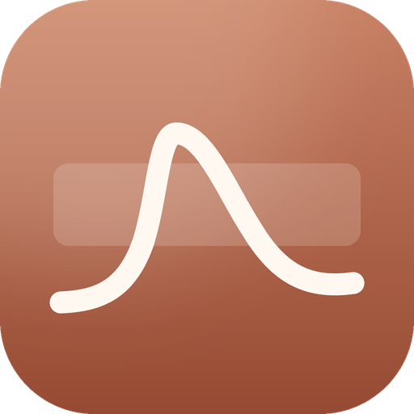

# Misaka hrt记录器



离线运行的 HRT 记录与血药浓度估算应用，**Android、iOS、Windows 三端同一份代码**。界面用 Flutter（Material 3，桌面端另有专门的宽屏布局），药代动力学模型用 Rust 写成原生库（Android 用 `libhrt_core.so`、iOS 静态链接、Windows 用 `hrt_core.dll`）。所有数据只保存在本地：没有账号、没有服务器，**Android 版不申请任何网络权限**。

**English**: an offline HRT tracker and concentration modeller for Android, iOS and Windows from one Flutter (Material 3) codebase, with the pharmacokinetic model in Rust as a native library. Everything stays on the device; the Android build requests no network permission at all.

---

## 来源与致谢 / Credits

本项目是 **[Oyama's HRT Tracker](https://github.com/xunxunProjects/Oyama-s-HRT-Tracker)** 的 Android 重写版本，原作由 **Joseph Smirnova Oyama（[@SmirnovaOyama](https://github.com/SmirnovaOyama)）** 以 MIT 许可证发布。本仓库只包含重写后的 Android 实现，**不包含上游的 Web / Tauri / Worker 源码**；需要对照原实现请访问上游仓库。

> This is an Android rewrite of **Oyama's HRT Tracker** by **Joseph Smirnova Oyama**, used and redistributed under the MIT License. This repository contains only the rewritten Android client — the upstream web/Tauri/worker sources are not vendored here; see the upstream repository for those.

雌二醇的药代动力学模型来自 **[@LaoZhong-Mihari](https://github.com/LaoZhong-Mihari)** 的 [HRT-Recorder-PKcomponent-Test](https://github.com/LaoZhong-Mihari/HRT-Recorder-PKcomponent-Test)（`PKcore.swift` / `PKparameter.swift`）：三室结构、双相注射储库动力学与舌下吸收档位均沿用该模型。

算法说明可参考上游的 [Algorithm Explanation.md](https://github.com/xunxunProjects/Oyama-s-HRT-Tracker/blob/main/Algorithm%20Explanation.md)。详见 [NOTICE.md](NOTICE.md)。

## 下载 / Download

最新版本在 [Releases](https://github.com/imisakamikoto/misaka-hrt-tracker/releases)：

| 文件 | 平台 | 说明 |
|---|---|---|
| `Misaka-hrt-1.1.1-arm64-v8a.apk` | Android | 绝大多数手机（推荐） |
| `Misaka-hrt-1.1.1-armeabi-v7a.apk` | Android | 老款 32 位机型 |
| `Misaka-hrt-1.1.1-x86_64.apk` | Android | 模拟器 |
| `Misaka-hrt-1.1.1-ios.ipa` | iOS | **未签名**，需用 AltStore / Sideloadly / Xcode 用你自己的 Apple ID 重签 |
| `Misaka-hrt-1.1.1-windows-x64.msi` | Windows | 双击安装，开始菜单建快捷方式；需要 Windows 10 1809 以上（x64） |

Android 7（API 24）及以上，iOS 15 及以上，Windows 10 1809 / Windows 11。Android 版当前用 debug key 签名，直接安装即可；上架商店需要自建 keystore。iOS 未签名包只能自签安装，无法直接双击装进 iPhone——这是苹果的限制，本项目不附带证书。

## 功能

- **记录**：注射、口服、舌下、凝胶、贴片，凝胶部位、贴片释放率与佩戴时长、舌下含服档位；快捷剂量与模板；按天分组的历史与热力图。
- **估算**：目标带、当前浓度、CPA / 睾酮曲线，1 / 3 / 7 / 30 天窗口，拖动读数；此刻之后按用药计划画虚线预测。
- **校准**：MIPD、扩展卡尔曼（EKF）、OU-Kalman，前向 / 回溯两种历史模式。
- **检验**：录入结果（pg/mL、pmol/L、ng/dL、nmol/L），叠加到曲线并与模型对账。
- **计划与库存**：周期性方案、今日待服、下一次服药；库存剩余与用完日期。
- **提醒**：模型预测浓度跌破目标带下沿前提醒服药（仅非注射方案），可选的到点提醒，精确闹钟不可用时自动降级；重启后由 `BOOT_COMPLETED` 接收器恢复。
- **备份**：完整备份、仅记录、加密备份（PBKDF2-SHA256 600k + AES-256-GCM）、只读快照；导入兼容本项目四种历史格式，可合并或替换。
- **外观**：Material 3、Material You 动态取色（Android）、浅色/深色/单色、简体/繁体/粤语/英/日/韩/土耳其语。
- **桌面端布局**：窗口内是永久导航抽屉 + 工具栏，概览为「曲线 + 今日计划 + 检验/库存」双栏看板，历史是一张可悬停出操作的行表格，`Ctrl+1…7` 切页、`Ctrl+N` 记录、`Ctrl+R` 重算、`F1` 看快捷键。

## 构建

需要 Flutter 3.47+ 与 Rust 1.99+，外加各平台自己的工具链。

**Android**（macOS / Linux / Windows 均可）

```bash
rustup target add aarch64-linux-android armv7-linux-androideabi x86_64-linux-android
cargo install cargo-ndk            # 一次性
flutter pub get
flutter build apk --release --split-per-abi
```

Gradle 的 `buildRustCore` 任务会在 `preBuild` 前用 cargo-ndk 交叉编译 `rust/`，把 `libhrt_core.so` 放进 `android/app/src/main/jniLibs`；没装 Rust 工具链时会跳过、复用已有 `.so`。

**iOS**（需要 macOS + Xcode）

```bash
bash rust/build_ios.sh             # 静态库，device + 模拟器
flutter build ios --release --no-codesign
mkdir -p Payload && cp -R build/ios/iphoneos/Runner.app Payload/
zip -qry Misaka-hrt-ios.ipa Payload
```

iOS 不允许加载 bundle 外的动态库，所以这里用静态库：`-force_load` 由 `ios/Flutter/*.xcconfig` 指定，Dart 侧走 `DynamicLibrary.process()`。

**Windows**（需要 Visual Studio 2022 + WiX 3）

```powershell
cargo build --release --manifest-path rust/Cargo.toml   # 产出 hrt_core.dll
flutter build windows --release
powershell -ExecutionPolicy Bypass -File packaging/windows/build_msi.ps1 -Version 1.1.0
```

CMake 会把 `hrt_core.dll` 拷到 exe 旁边，`build_msi.ps1` 用 heat / candle / light 把整个 Release 目录打成一个 MSI。

两端都在 [`.github/workflows/build-installers.yml`](.github/workflows/build-installers.yml) 里自动构建，推 `v*` 标签即产出 IPA 与 MSI。更多细节见 [BUILD.md](BUILD.md)。

## 测试

```bash
cd rust && cargo test     # 8 项：解析、配对、量级
cd .. && flutter test     # 22 项：领域逻辑、备份、Dart ⇄ Rust 端到端
```

三端共用同一套 Dart 代码与同一份 Rust 内核，测试跑一次就能覆盖。

## 仓库结构

```
lib/                  Flutter 界面与状态（ui/desktop/ 是桌面端布局）
rust/                 药代动力学内核（cdylib / staticlib / rlib）+ build_ios.sh
android/              Gradle、Manifest、BootReceiver、jniLibs
ios/                  Xcode 工程，静态链接 Rust 内核
windows/              CMake 工程，加载 hrt_core.dll
packaging/windows/    WiX 源与 MSI 打包脚本
test/ tool/           单元测试与离线校验脚本
BUILD.md              三端构建与签名说明
CONTRIBUTING.md       怎么改、守哪几条线
SUPPORT.md            遇到问题先去哪
SECURITY.md           隐私与漏洞的报告方式
NOTICE.md             来源与第三方声明
LICENSE               MIT
```

## 参与 / Contributing

个人维护的离线应用，欢迎 bug 报告、翻译和界面改进。

- **怎么改、守哪几条线** → [CONTRIBUTING.md](CONTRIBUTING.md)（不联网、数据只在本机、模型层不做 I/O）
- **提 issue 前先看** → [SUPPORT.md](SUPPORT.md)：使用问题去 Discussions，崩溃去 Issues，安全问题走私密渠道
- **隐私与漏洞** → [SECURITY.md](SECURITY.md)
- **行为准则** → [CODE_OF_CONDUCT.md](CODE_OF_CONDUCT.md)

报 bug 时**请用自己编的样例数据**，不要贴真实的检验单或用药记录。

## 免责声明

本应用给出的是**模型估算值，不是医疗建议**，也不能替代化验。用药请遵医嘱。

## 许可证

MIT，见 [LICENSE](LICENSE)。上游版权归 Joseph Smirnova Oyama 所有，Android 重写部分版权归本项目贡献者所有。
